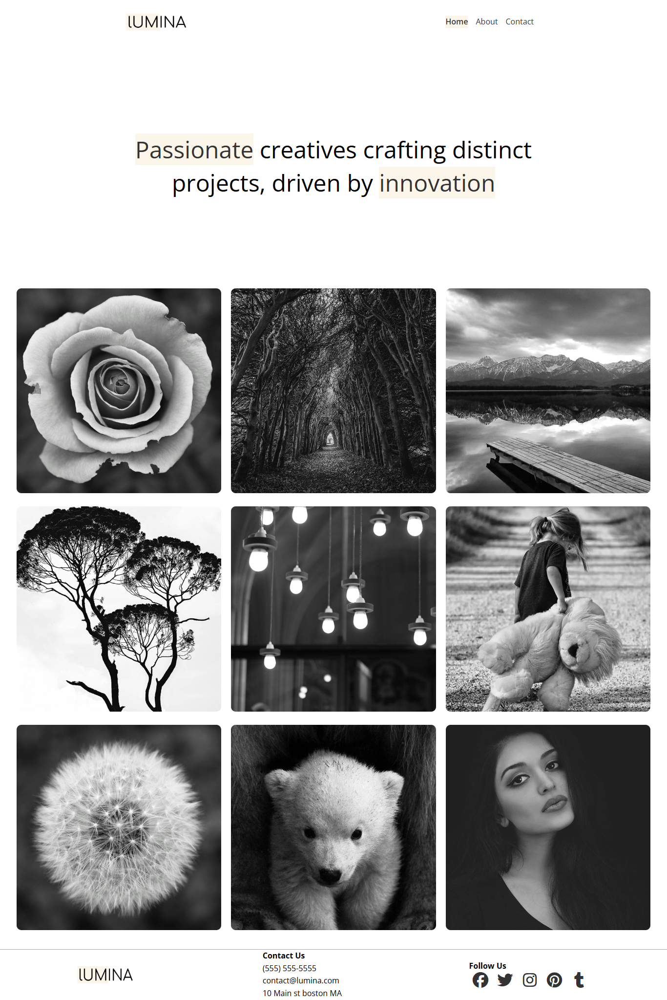
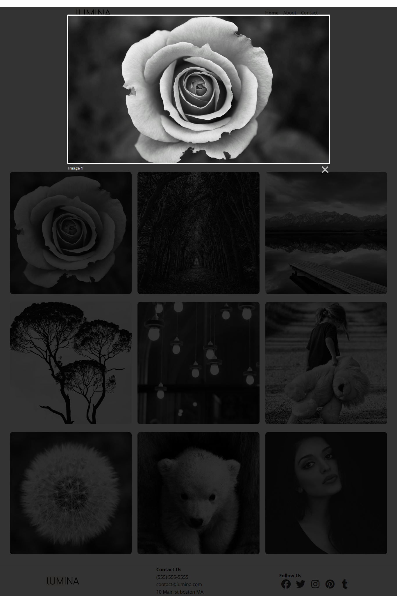
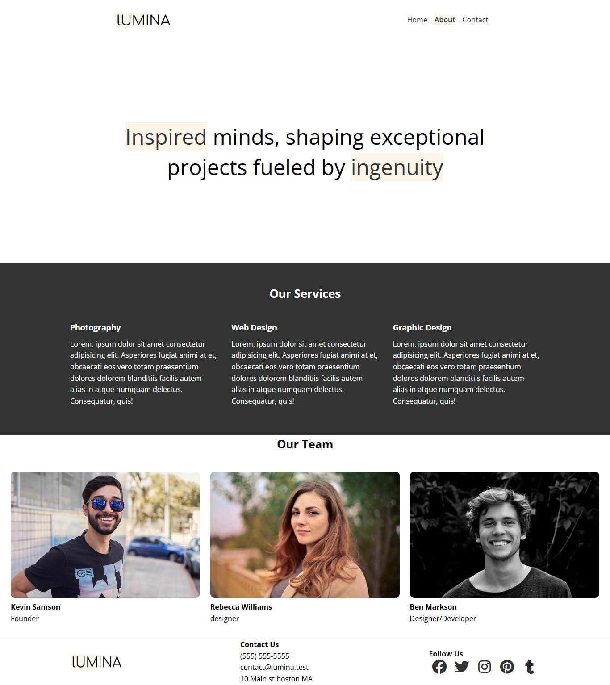
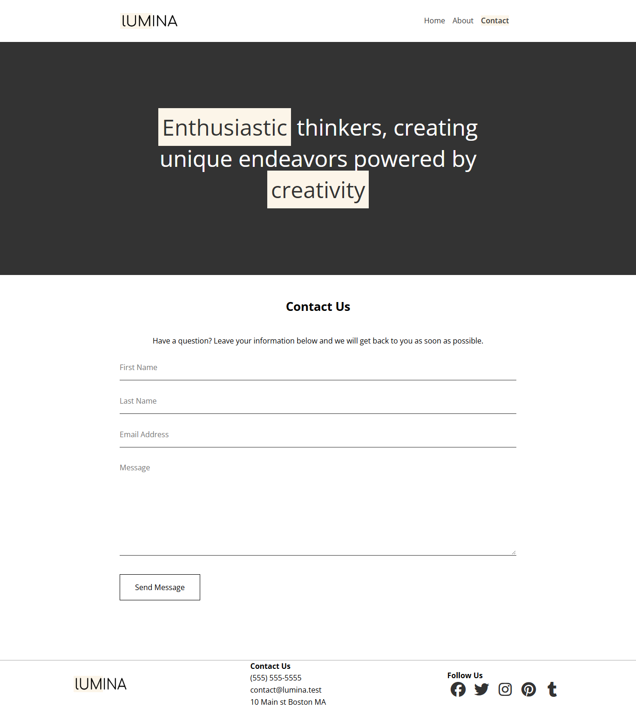

# ✨ Lumina Creative — Creative Agency & Portfolio Website

[](https://lumina-creative-psi.vercel.app/)
[](https://developer.mozilla.org/en-US/docs/Web/HTML)
[](https://developer.mozilla.org/en-US/docs/Web/CSS)
[](https://developer.mozilla.org/en-US/docs/Web/JavaScript)
[](LICENSE)

A modern, responsive, and minimalist website designed for creative agencies, photography studios, and digital designers. Built with semantic HTML5, custom modern CSS, and integrated with Lightbox2 for an interactive gallery experience.

🔗 **Live Demo:** [lumina-creative-psi.vercel.app](https://lumina-creative-psi.vercel.app/)

---

## 📸 Screenshots & Preview

### 🏠 Home Page & Portfolio Gallery
Clean hero section highlighting brand philosophy paired with a responsive 3x3 photography grid.



---

### 🔍 Interactive Lightbox Preview
Clicking on any portfolio item opens a full-screen, high-resolution modal with smooth transitions powered by Lightbox2.



---

### 👥 About Page (Services & Team)
Showcases core agency offerings (Photography, Web Design, Graphic Design) and the creative team behind the projects.



---

### ✉️ Contact Page
Clean, minimalist contact interface configured with Netlify form integration for direct client inquiries.



---

## 🌟 Key Features

- **Responsive Design:** Fluid layouts optimized for desktop, tablet, and mobile screens.
- **Interactive Photo Gallery:** Dynamic lightbox overlay supporting image zoom and navigation.
- **Minimalist Aesthetic:** Clean typography, curated whitespace, and high-contrast monochrome design.
- **Multi-page Structure:** Includes dedicated `Home`, `About`, and `Contact` pages.
- **Form Ready:** Contact form pre-configured for deployment with Netlify forms.
- **Zero Heavy Frameworks:** Pure, fast-loading HTML & CSS with lightweight external libraries.

---

## 🛠️ Built With

- **HTML5:** Semantic markup structure for accessibility and SEO.
- **CSS3:** Custom styles utilizing Flexbox, CSS Grid, and custom variables.
- **Google Fonts:** [Open Sans](https://fonts.google.com/specimen/Open+Sans) typography.
- **FontAwesome:** Scalable vector icons for social media and navigation.
- **jQuery & Lightbox2:** Smooth modal image previews.
- **Deployment:** Hosted on [Vercel](https://vercel.com).

---

## 📁 Project Structure

```text
LuminaCreative/
├── css/
│   └── styles.css              # Custom styling & responsive layouts
├── images/                     # Project assets, icons, and portfolio photos
├── readme_images/              # Full-page screenshots for documentation
│   ├── screencapture-lumina-creative-psi-vercel-app-2026-10-25-17_49_12.png
│   ├── screencapture-lumina-creative-psi-vercel-app-2026-10-25-17_49_30.png
│   ├── screencapture-lumina-creative-psi-vercel-app-about-2026-10-25-17_49_51.png
│   └── screencapture-lumina-creative-psi-vercel-app-contact-2026-10-25-17_50_04.png
├── index.html                  # Home page & portfolio gallery
├── about.html                  # About page with services and team section
├── contact.html                # Contact page with submission form
└── readme.md                   # Project documentation
```

---

## 🚀 Getting Started

To explore or run this project locally on your machine:

### 1. Clone the repository
```bash
git clone https://github.com/sajidsam/LuminaCreative.git
```

### 2. Navigate to the project directory
```bash
cd LuminaCreative
```

### 3. Open in your browser
Simply double-click on `index.html` or open it using VS Code Live Server:
```bash
# If using VS Code Live Server or similar local server
npx serve .
```

---

## 📬 Contact & Author

- **GitHub:** [@sajidsam](https://github.com/sajidsam)
- **Website:** [Lumina Creative](https://lumina-creative-psi.vercel.app/)

---

⭐ *If you find this project helpful, feel free to give it a star!*